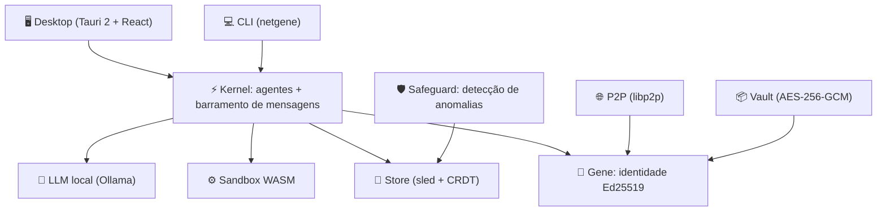

# NetGene OS 🧬

### A camada de confiança para agentes de IA: identidade criptográfica, permissões verificáveis e execução isolada, numa malha privada entre os seus dispositivos.

[](https://mnemosyne-one.com)
[](#licença)
[](#estado-real-de-cada-módulo)

> **Alpha.** As falhas críticas da auditoria foram fechadas na v0.4.0, mas o NetGene OS ainda não passou por auditoria externa. A tabela [Estado real](#estado-real-de-cada-módulo) diz exatamente o que funciona e quais limites continuam.

---

## Por que o NetGene existe

Agentes de IA estão ganhando acesso a arquivos, redes, chaves e APIs. Hoje quase nenhum deles tem uma identidade própria, um limite claro do que pode fazer ou um registro auditável do que fez. Esse é o problema que o NetGene quer resolver:

| Quem | O que ganha |
|---|---|
| **Usuário final** | Um assistente de IA local que roda nos seus dispositivos (PC, notebook e, no futuro, celular), sem nuvem de terceiros. Cada agente só faz o que você autorizou. |
| **Desenvolvedores** | Um runtime para publicar agentes e plugins WASM assinados, com permissões declaradas, que qualquer pessoa pode instalar com segurança. |
| **Empresas e big techs** | Uma camada auto-hospedada de identidade e política para frotas de agentes: cada ação é atribuída a uma identidade, limitada por capacidades e registrada, sem depender de um fornecedor. |

**O diferencial:** a proposta não é ser mais uma VPN mesh (NetBird, Tailscale e Nebula já fazem isso bem), nem mais um framework de agentes. O NetGene é a peça que falta entre os dois. É a camada que diz **quem** é cada agente, **o que** ele pode fazer e **onde** ele pode rodar.

---

## Arquitetura



Mais detalhes em [netgene-core/docs/ARCHITECTURE.md](netgene-core/docs/ARCHITECTURE.md).

---

## Estado real de cada módulo

✅ funciona · 🧪 experimental (funciona em parte, com limitações conhecidas) · ⛔ não use para dados reais

| Crate | Estado | O que faz de verdade | Limitação conhecida |
|---|---|---|---|
| `netgene-gene` | ✅ | Identidades Ed25519 (via `ring`), fingerprint SHA3-256 e hierarquia Master → sub-genes com **linhagem assinada e verificável**. A chave privada fica no **cofre do sistema** (Windows Credential Manager, macOS Keychain, Linux Secret Service), nunca em disco. | Ainda não há assinatura pós-quântica (prevista para a Fase 2). |
| `netgene-p2p` | ✅ | Nó libp2p: TCP + Noise + Yamux, Gossipsub assinado com validação estrita, mDNS e Kademlia. O **PeerId é derivado da Gene**, e só entram nós da mesma linhagem (allowlist). | libp2p 0.54 traz avisos de segurança em dependências transitivas (atualização prevista). Não há NAT traversal. |
| `netgene-store` | ✅ | Banco local (sled) para nós, eventos e memória de agentes, com registrador CRDT LWW. | `sled` está sem manutenção ativa. Migração prevista para `redb`. |
| `netgene-llm` | ✅ | Cliente Ollama (chat/generate) e parser de intenções com fallback por regras. | Modelo e URL fixos (`llama3`, `localhost:11434`). |
| `netgene-kernel` | 🧪 | 5 agentes em tasks Tokio, barramento de mensagens, memória e marketplace local com **manifestos assinados** (verificados ao publicar, listar e instalar) e ids validados. | A saída do LLM vira ação sem motor de políticas (Fase 2). |
| `netgene-safeguard` | 🧪 | Detecção de anomalias por z-score em janela deslizante. | As ações de "self-healing" são apenas registradas, não executadas. |
| `netgene-wasm` | ✅ | **Executa** módulos assinados (Ed25519) por um autor confiável, com wasmtime 36 LTS, limite de CPU (fuel) e de memória, e sem imports de host (sem WASI, rede ou arquivos). | A ABI v1 é mínima (`run() -> i32`) e ainda não recebe entrada. |
| `netgene-vault` | 🧪 | Cifra arquivos em pedaços com AES-256-GCM. A chave fica no cofre do sistema e **sobrevive a reinícios**. Cada pedaço é ligado ao arquivo, à posição e ao total (AAD). | Só local: ainda não há replicação entre dispositivos. Arquivos de versões ≤ 0.3 não podem ser lidos (a chave antiga se perdia). |
| `netgene-desktop` | 🧪 | Painel de nós, eventos, agentes, marketplace (assina com uma Gene local), vault e terminal de intenções. | Sem autenticação local (passkeys reais estão previstos). |
| `netgene-cli` | ✅ | Comandos `gene` (init, spawn, verify, export, import), `agent` (dispatch, publish, market), `store`, `llm`, `p2p`, `wasm` (sign, run) e `vault`. | — |

**Removido na versão 0.3.0:** os módulos quântico/QAOA, QPU, BCI neural, DAO, TPM, eBPF, Kubernetes, IoT lite, cloud mesh, builder, TUI e o "FHE". Eles eram simulados (valores fixos ou verificações que sempre aceitavam) e davam garantias que não existiam. O histórico do git preserva o código. Alguns podem voltar quando houver uma implementação real (por exemplo, eBPF com `aya` ou TPM com `tss-esapi`). O motivo de cada remoção está em [AUDITORIA_2026-10.md](AUDITORIA_2026-10.md).

---

## Como executar

**Pré-requisitos:** [Rust](https://rustup.rs/) estável (testado com 1.94), [Node.js](https://nodejs.org/) 20+ para o desktop e, opcionalmente, [Ollama](https://ollama.com/) com o modelo `llama3`.

```bash
cd netgene-core
cargo test --workspace
```

```bash
cargo run -p netgene-cli -- gene init --name minha-identidade
```

```bash
cargo run -p netgene-cli -- p2p listen --gene <ID-da-gene> --port 7777
```

O ID aparece em `gene init`. Outros nós entram se forem sub-genes da mesma Master (`gene spawn`, depois `gene export` e `gene import` no outro dispositivo).

```bash
cd netgene-desktop && npm install && npm run tauri dev
```

**Docker** (nó P2P headless):

```bash
docker build -t netgene netgene-core
```

---

## Roadmap

O plano completo está em [ROADMAP.md](ROADMAP.md). Resumo:

1. **Fase 0 (concluída):** higiene do repositório, CI funcional, licença e documentação honesta.
2. **Fase 1 (concluída, v0.4.0):** chaves no cofre do sistema, vault persistente e autenticado, WASM assinado e executado de fato, marketplace assinado, P2P com identidade Gene e allowlist.
3. **Fase 2:** núcleo real. Identidade híbrida pós-quântica (Ed25519 + ML-DSA), malha autenticada, runtime WASM com permissões, motor de políticas para as ações do LLM e `redb`.
4. **Fase 3:** produto. Marketplace assinado, app mobile, eBPF no Linux, SSO e integrações empresariais.

---

## Segurança

O NetGene OS ainda não passou por auditoria de segurança externa. Use com cautela antes disso. Para reportar uma vulnerabilidade, abra uma *security advisory* privada no GitHub em vez de uma issue pública.

## Licença

Distribuído sob [MIT](LICENSE-MIT) **ou** [Apache-2.0](LICENSE-APACHE), à sua escolha.
